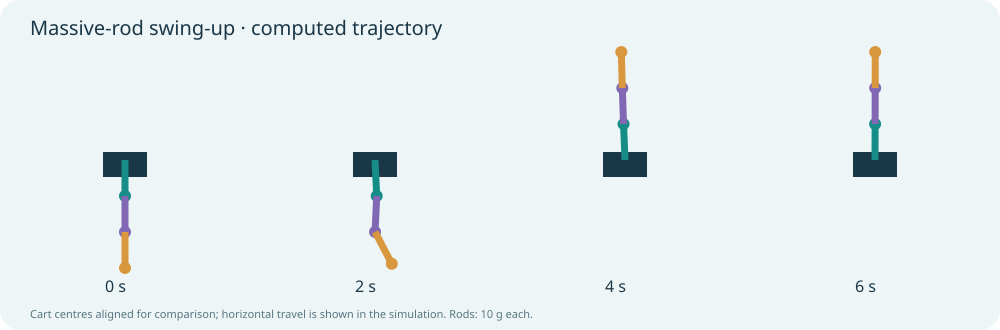
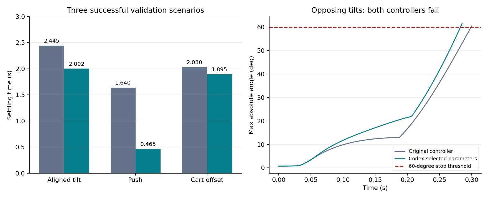

# Inverted Pendulum Control

**Louis Gosset · An educational numerical study of modelling, feedback and nonlinear swing-up.**

How can one horizontal cart force raise and balance three freely rotating links? This project connects Lagrange equations, state-space linearisation, controllability, Riccati-based LQR design and constrained nonlinear simulation.



**[Project overview](https://LGOSSET-21.github.io/inverted-pendulum-control/) · [Live demo](https://LGOSSET-21.github.io/inverted-pendulum-control/visualization/massive-recovery.html) · [Read the report](https://LGOSSET-21.github.io/inverted-pendulum-control/reports/Project_Report.pdf)**

## Start here

- **[Project report (PDF)](reports/Project_Report.pdf)** — detailed calculations; pages 1–7 cover the massless model and pages 8–9 the massive-rod extension and future work.
- **[Interactive massive-rod recovery](visualization/massive-recovery.html)** — **[open the live demonstration](https://LGOSSET-21.github.io/inverted-pendulum-control/visualization/massive-recovery.html)**. Apply a force to any mass, observe the cart respond, and follow hanging recovery → swing-up → upright balance with live plots.
- [Recorded massive-rod swing-up](visualization/massive-swingup.html) — the reproducible saved experiment used for the reported metrics.
- [Near-upright model comparison](visualization/massive-rods.html) and [interactive massless-rod reference](visualization/triple.html). The massless version remains a useful baseline; “massless” refers to the rods, not the endpoint masses.

The browser demonstrations work offline. The new massive-rod page integrates the nonlinear equations live; the hand applies a Cartesian force through the selected point’s Jacobian, without imposing link angles. The swing-up follows the embedded, precomputed trajectory with time-varying feedback. Small pulls can be rejected; strong pulls can cause a fall. Automatic recovery uses the real state without resetting it. See [interaction, limits and verification](docs/interactive-recovery.md).

The massless reference and recorded experiments remain unchanged. Comparing models changes total suspended mass as well as its distribution, so this is not a controlled hardware comparison. Python is required only to reproduce calculations.

## Results and scope

| Massive-rod experiment | Outcome |
|---|---|
| Three 10 g uniform rods added to existing endpoint masses | Suspended mass increases from 200 to 230 g |
| Aligned initial tilt of 1 degree | Settles at 2.1225 s |
| Swing-up from exactly hanging, at rest | Settles at 6.380 s |
| Maximum force and cart displacement during swing-up | 8 N and 0.721 m |
| Opposing initial tilts (+1, −1, +1 degrees) | Fails at the local experiment's tilt cutoff |

The table reports the saved experiments, not arbitrary interactive runs. These are model-specific numerical results, not measured hardware performance or global stability guarantees. All hinges are passive. Rods are rigid, sensing and force actuation ideal, and collisions are not modelled. Cart viscous friction is included; joint friction, delay and sensor noise are not. The LQR stability statement applies locally to the unsaturated linearised system.

The massive model includes each rod's centre-of-mass translation, rotation with inertia **I = mL²/12**, and gravity. The swing-up is re-optimised for this model and independently replayed with saturation. It is not animation keyframing. [Derivation and reproduction details](docs/massive-rods.md).

## Reproduce

Python 3.11 and Node.js 20+ are recommended. Node is required for browser-physics cross-checks; no npm dependencies are needed.

```bash
python3 -m venv .venv
source .venv/bin/activate
python -m pip install -r requirements.txt
python -m unittest discover -s tests -v
node tests/test_massive_swingup_page.cjs
node tests/test_massive_recovery_physics.cjs
node tests/test_massive_recovery_fall.cjs
node tests/test_massive_recovery_page.cjs
python src/build_massive_swingup.py
```

On Windows, activate with `.venv\Scripts\activate` instead. The saved massive-rod reference is included. Optional replanning (`python src/plan_massive_swingup.py`) may be slow and is not required to view or replay the result. `python src/build_massive_rods.py` rebuilds the near-upright comparison. Tests and planners may take several minutes.

Verification includes independent rigid-body energy calculations, mechanical power balance, the zero-rod-mass limit, finite-difference linearisation, Riccati checks, and halved integration steps. Original development recorded 25 passing Python tests; see the research log for the distinction between automated page checks and visual browser inspection.

## Repository contents

- `src/`: physical models, controllers, planners and page generators.
- `tests/`: numerical verification and browser-handler regression tests.
- `results/`: saved reference trajectories, CSVs and metrics.
- `visualization/`: offline demonstrations and editable templates.
- `docs/`: massive-rod derivation and numerical assumptions.
- `reports/`: professor-facing report.

## Future work — not yet implemented

1. Robustness maps for mass uncertainty, perturbed initial conditions and pushes during swing-up.
2. Noisy measurements, delays and state estimation.
3. Quantify the recovery region and interaction robustness for the live massive-rod model.
4. Compare precomputed trajectory tracking with online replanning/MPC; explore energy-based alternatives without assuming a simple-pendulum law transfers directly to three links.
5. Hardware identification and validation.

## Authorship and references

This is Louis Gosset's learning project. AI tools assisted implementation, debugging, mathematical explanations and report preparation. Established methods are not claimed as original inventions. The saved computations, tests and limitations support technical discussion; understanding and explaining the work remain part of the learning process.

Background: [University of Michigan CTMS — inverted pendulum](https://ctms.engin.umich.edu/CTMS/index.php?example=InvertedPendulum&section=SystemModeling), [MIT Underactuated Robotics](https://underactuated.mit.edu/). The chronological [research log](RESEARCH_LOG.md) includes superseded approaches; the README and model documentation describe the current scope.

## Companion project

[Next: physics-informed flow reconstruction](https://LGOSSET-21.github.io/pinn-hemodynamics/).

## Agent-supervised experiments (V1)

The optional supervisor tunes upright massive-rod LQR weights between simulations.
It never replaces the timestep controller. Run from the repository root:

```bash
PYTHONPATH=src python -m agentic tune --policy offline --budget 12 --output runs
# Optional LLM backend (explicit API model; requires OPENAI_API_KEY):
python -m pip install -r requirements-agent.txt
PYTHONPATH=src python -m agentic tune --policy llm --model YOUR_MODEL --budget 12 --output runs
```

Offline mode is deterministic coordinate search, not LLM reasoning. Each run
gets a unique directory containing `events.jsonl`, `summary.json`, and per-candidate
metrics and numerical trajectories. API errors stop explicitly without switching
policies. No API key is stored. The original version is preserved on
[`baseline/pre-agent-v1`](https://github.com/LGOSSET-21/inverted-pendulum-control/tree/baseline/pre-agent-v1).

### Reproduce the benchmark

```bash
PYTHONPATH=src python -m agentic benchmark --budget 12 --seed 21 --output runs
# Compare a completed LLM session from the same clean source revision:
PYTHONPATH=src python -m agentic benchmark --llm-summary runs/run-ID/summary.json --output runs
```

The benchmark runs four tuning scenarios per candidate, freezes selection, then
compares the original controller, adaptive search and log-uniform random search
on four held-out scenarios. Search budgets include the baseline candidate. An
imported LLM run sets both comparator budgets to its actual candidate count.
Each selected controller is independently replayed with half the integration step.
Allow several minutes for the default 116 simulations (96 tuning, 12 validation,
8 refinement). Results are written to `benchmark.json` and `benchmark.md` in a
new run directory; full traces and logs stay in ignored `runs/` directories.

The four tunable factors multiply cart position, link angle, velocity and force
weights in the original LQR cost; each is bounded to [0.1, 10]. Force remains
limited to 8 N, and simulations terminate at 60 degrees or 2 m cart travel.
Settling requires all links within 1 degree, angular speeds below 0.05 rad/s,
cart position within 0.02 m and speed below 0.03 m/s through the end of the run,
with at least one second observed. Recovery times start at the end of a pulse.
Ranking first minimizes failed/unsettled scenarios, then travel violations
(0.5 m), then mean normalized time, displacement and squared-force cost.

Tools are `set_controller_parameters`, `run_experiment`, `get_experiment` and
`compare_experiments`. A session defaults to 12 candidates and 60 tool calls;
invalid calls consume the call budget. The program selects the best measured
candidate even if the LLM claims a different result. LLM requests use a 60 s
request timeout, one retry and 2000 output tokens per response. API calls can
incur charges; offline mode uses no API. Model access depends on your API account.

The optional backend follows the official [Responses function-calling protocol](https://developers.openai.com/api/docs/guides/function-calling).
Protocol behavior is tested with scripted responses, without paid calls. Live
API execution is not part of the recorded offline benchmark. This V1 covers
local upright recovery, not swing-up, recovery after a fall, or hardware safety.
One seed and four held-out cases cannot establish general superiority.

Python callers can also run one experiment directly:

```python
from agentic import ControllerParameters, Scenario, run_simulation, evaluate

scenario = Scenario('cart_offset', (0.05, 0, 0, 0, 0, 0, 0, 0))
trajectory = run_simulation(scenario, ControllerParameters(cart=2.0))
print(evaluate(trajectory))
```

The state order is `[x, v, theta1, omega1, theta2, omega2, theta3, omega3]` in SI
units, with absolute angles measured from upright. Run with `PYTHONPATH=src`.
Pulse boundaries and simulation duration must align with the integration grid.

Ctrl-C finalizes an interrupted-session summary (exit code 130), preserving
completed candidates and any completed scenario traces from the interrupted
candidate. Incomplete candidates are excluded from winner selection. Interrupted
benchmarks produce `interrupted.json`, not a completed benchmark report. Initial
state magnitudes above 1e6 SI are rejected before numerical work; this is a
numerical input guard, not an expanded physical operating range.

### Recorded result (offline, seed 21)

See [the full benchmark table](results/agentic/benchmark.md) and
[machine-readable metrics](results/agentic/benchmark.json).

| Method | Validation failures / 4 | Composite validation cost (lower is better) |
|---|---:|---:|
| Original controller | 1 | 0.5422 |
| Adaptive coordinate search, 12 candidates | 1 | 0.4691 |
| Random search, 12 candidates | 1 | 0.4471 |

Adaptive search reduces the composite cost by about 13.5% versus the original
controller. Random search is better on this held-out set despite a slightly
worse tuning score. All three fail the opposing-angle scenario; recovery
success is still 3/4, not improved. Some faster recoveries require more effort.
This demonstrates a functioning experimental loop and an honest comparator,
not an LLM advantage. No live LLM result is included.

All eight refinement runs preserve completion status; maximum state discrepancy
is below 0.0045 SI and observed settling-time differences are at most 0.00125 s.
The full run used 116 simulations and about 344 s on the development machine;
runtime depends on hardware and concurrent work. [Verification record](docs/agent-v1-verification.md).

### Codex-supervised demonstration

A separate conversation-driven experiment selected four parameter sets, then
froze the winner for validation. Its composite validation cost is **0.4676**
versus **0.5422** for the original controller (13.76% lower); push settling drops
from **1.640 to 0.465 s**. Both still recover **3/4** validation scenarios.
Eight step-refinement comparisons preserve completion/settling status.



[Decisions, recovery curves, archived traces and reproduction instructions](results/agentic/codex-demo/README.md)
are included. Prior benchmark results were visible, and the earlier random-search
result remains better. This demonstrates LLM-guided experimentation in Codex,
not a blind comparison or a live test of the optional API policy.
