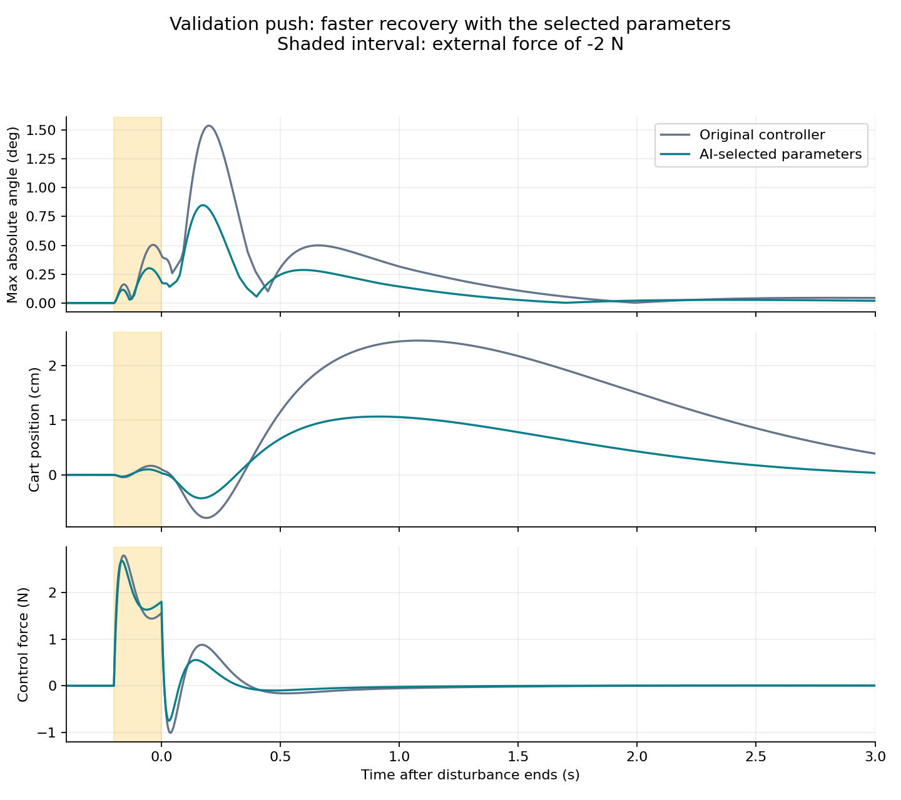

# AI-supervised tuning demonstration

An OpenAI Codex assistant selected four LQR parameter sets sequentially after inspecting
simulation results. This was supervision in a conversation, without a separate
OpenAI API call. It is distinct from the automated `--policy llm` API integration.
Previous benchmark results were visible to the assistant: this is **not a blind
comparison or evidence of LLM superiority**.

## Decisions and tuning results

Each candidate was evaluated on all four tuning scenarios (16 simulations).
Parameters scale the existing Q/R weights; the physical force limit stays at 8 N.

| Trial | Cart | Angles | Velocities | Effort | Tuning cost | Decision |
|---|---:|---:|---:|---:|---:|---|
| 1 | 1 | 1 | 1 | 1 | 0.474536 | Original controller reference |
| 2 | 1 | 1 | 1 | 4 | 0.528380 | Penalizing effort more did not resolve saturation; reject |
| 3 | 1 | 1 | 1 | 0.25 | 0.430027 | Lower effort penalty improved recovery; retain |
| 4 | 2 | 1 | 1 | 0.25 | 0.416457 | Increase cart-position weight; select |

All candidates fail the opposing-angle scenario. The 12.24% tuning-cost reduction
does not represent an improvement in recovery success rate.

## Frozen-parameter validation

The fourth candidate was frozen before this validation run. Both it and the
original controller were evaluated on the four existing validation scenarios,
at dt = 0.0025 s and dt = 0.00125 s (16 additional simulations).
Source revision: `12ca606db855747233f89745d463e3a095e0a974`, clean working tree.
Duration: 12 s; rod mass: 0.01 kg; identical disturbances and limits.

| Controller | Failed / unsettled | Travel violations | Composite cost |
|---|---:|---:|---:|
| Original | 1 / 4 | 0 | 0.542186 |
| AI-selected | 1 / 4 | 0 | 0.467603 |

The composite cost decreases by **13.76%**. Ranking prioritizes failure count,
then travel violations, then the composite cost; the failure is not excluded.
The composite is a dimensionless combination of settling time, cart excursion,
and control effort (see `src/agentic/metrics.py`).

| Validation scenario | Original settling (s) | Selected settling (s) |
|---|---:|---:|
| Aligned tilts | 2.4450 | 2.0025 |
| External push | 1.6400 | 0.4650 |
| Cart offset | 2.0300 | 1.8950 |
| Opposing tilts | Failed | Failed |


Settling after the push is measured from the end of the disturbance and checks
the full settling criteria, not only the plotted angle envelope.



## Numerical checks and limits

All eight coarse/fine comparisons preserve completion and settling status.
Maximum state-component difference on the common time interval is 0.005232
in SI units, below the existing 0.01 warning threshold; maximum settling-time
difference is 0.00125 s. This is a step-refinement check, not a proof of accuracy.

Recovery success stays at **3/4**. Some improvements require more control effort.
The prior seeded random-search result (0.4471 validation cost) remains better
than this demonstration (0.4676); budgets and prior information differ, so these
runs do not establish a fair ranking of search policies. Validation scenarios
were already known from the earlier benchmark. No live API integration, swing-up,
hardware performance, or general robustness claim is established here.

## Archived evidence and reproduction

- `tuning-events.jsonl`: decisions, tool interactions and tuning metrics.
- `tuning-summary.json`: selected parameters and tuning provenance.
- `validation-events.jsonl` and `validation.json`: validation metrics and provenance.
- `validation-baseline/` and `validation-codex_demo/`: all 16 compressed traces
  and their experiment records. Paths in these records resolve from this folder.
- `plot_results.py`: regenerates both figures from those traces.

From the repository root, in an environment with NumPy and Matplotlib:

```sh
python results/agentic/codex-demo/plot_results.py
```

To repeat the numerical evaluation, call `run_simulation` on each scenario from
`agentic.scenarios.validation_scenarios()` with `ControllerParameters()` and
`ControllerParameters(cart=2, angles=1, velocities=1, effort=0.25)`, duration 12,
and each of the two time steps above. Use `evaluate(result, after=pulse.end_s)`
for pulse scenarios and `after=0` otherwise. Historical tuning trajectory paths
in the tuning log refer to the original local run, whose traces are not bundled;
all validation traces used for the figures are bundled here.
